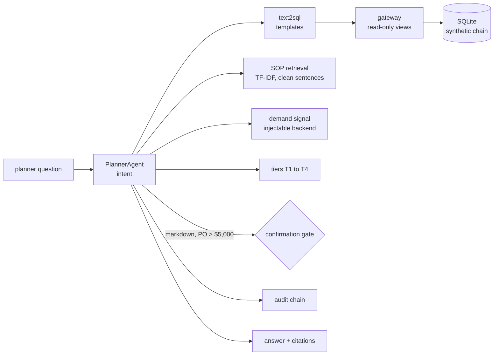

# Jagadish-retail-ops-agents

[](https://github.com/jagadishmazure-jpg/Jagadish-retail-ops-agents/actions/workflows/ci.yml)
[](https://github.com/jagadishmazure-jpg/Jagadish-retail-ops-agents/actions/workflows/codeql.yml)


**A planner assistant for a fictional retail chain: stockout risk, returns abuse and markdowns from least-privilege views, answers that quote the SOPs, escalation tiers, and purchase orders or markdowns held for human confirmation. Synthetic data, offline, with an optional Streamlit demo.**

> Personal learning and portfolio project. Everything runs offline on synthetic,
> fictional data with no API keys. Nothing is deployed. Numbers in this README
> come from real runs and are re-checked by CI (`scripts/render_docs.py --check`).

## Recruiter summary

- A ReAct-style planner calls three tools (inventory SQL, SOP retrieval, demand signal), names the worst case, cites the policy and assigns a tier.
- Real run: 18 SKUs at stockout risk with the worst at 0.0 days of cover against a 21-day lead time (T4); a customer with 14 returns, 10 suspicious (T3); a markdown proposal held as GATE-0001 for approval.
- Review fix: SOP quotes leaked markdown and were cut at 200 characters; now cleaned whole sentences, with a test that no quote ends mid-sentence.
- Security review (2026-10-18): three ways to read base tables past the view allowlist, a row cap a trailing comment could hide, and missed phone/SSN formats in feedback redaction; fixed with a SQLite authorizer, a fetch-time cap and new patterns. 94 tests.

## Purpose

Retail planning is a good test for agents because the data is tabular, the
policies are written down, and the risky actions (ordering stock, cutting
prices) have money attached. The assistant reads, explains and proposes; a
person approves. It uses the same design as the cold-chain repo, and the
overlap is documented in [docs/shared-spine.md](docs/shared-spine.md).

## Architecture



## How it works

**Data** (`retail/inventory.py`, `retail/views.py`): a seeded SQLite chain
of stores, SKUs, suppliers, sales and returns, exposed only through views
such as `v_stockout_risk`, `v_returns_watch`, `v_stock_status` and
`v_supplier_risk`. The gateway allows a single SELECT on those views.

**SQL** (`retail/text2sql.py`): intents map to fixed query templates.

**SOPs** (`retail/sop_rag.py`): TF-IDF over four SOP files; markdown
headings, list markers and emphasis are stripped and excerpts are whole
sentences.

**Tiers and gates** (`retail/replenishment.py`): tiers from stockout and
returns signals; markdowns, and purchase orders above $5,000, get a gate token
that must be approved or denied. Demo UI: `demo/app.py` (Streamlit, optional).
Architecture: [knowledge/architecture.md](knowledge/architecture.md).

**Feedback** (`retail/feedback.py`): a thumbs up or down per turn, plus a
required correction on a thumbs-down, is appended to the same hash-chained
audit log, so `verify_chain` covers feedback too. Emails, phone numbers (including
`(555) 123-4567`), SSNs and numbers of 10 or more digits in the correction
are replaced before it is written.

## Real code and output

```python
"""Planner questions against a synthetic retail chain (in-memory SQLite)."""
from pathlib import Path

from retail import inventory, orchestrator, views
from retail.audit import AuditLog
from retail.feedback import capture_feedback, list_feedback

ROOT = Path(__file__).resolve().parent.parent
conn = inventory.connect()
views.bootstrap(conn, seed=42)
agent = orchestrator.PlannerAgent(conn, str(ROOT / "docs" / "sops"))

for q in ["Which SKUs are at risk of stockout, and what does the SOP say?",
          "Who is abusing our returns policy?",
          "What should we mark down?"]:
    r = agent.ask(q)
    print(f"> {q}\n{r['answer']}\n")

print("pending confirmation gates:", [(g["token"], g["action"]) for g in agent.gate.pending()])
print("audit chain intact:", agent.audit.verify_chain())

# Feedback capture: thumbs up/down into the same hash-chained audit log, emails, phones, SSNs and long numbers redacted.
fb_log = AuditLog()
capture_feedback(fb_log, session_id="s-demo", turn_id="t1", rating="up")
fb = capture_feedback(fb_log, session_id="s-demo", turn_id="t2", rating="down",
                      correction="stock count was off, call me on +1 555 010 2030")
print(f"Feedback: {len(list_feedback(fb_log))} entries, stored correction {fb['details']['correction']!r}, "
      f"redactions {fb['details']['pii_redactions']}, chain verifies: {fb_log.verify_chain()}")
```

Output of `python examples/demo.py` (real run, re-checked in CI):

<!-- run: python examples/demo.py -->
```text
> Which SKUs are at risk of stockout, and what does the SOP say?
[stockout_risk] 18 row(s) from governed views.
Worst cover: Canned Black Beans 15oz at Downtown LA -- 0.0 days of cover (supplier SlowFreight Logistics, 21d lead).
Per the retail SOPs:
- sop-03-stockout-escalation.md §Detection: A SKU is at stockout risk when days of cover falls below the supplier's lead time in days. The assistant recomputes this continuously from POS velocity.
- sop-04-replenishment-policy.md §Purchase orders: The assistant drafts purchase orders from stockout-risk rows. Orders above $5,000 are gated behind human confirmation. The agent never sends a purchase order to a supplier autonomously.
- sop-01-returns-policy.md §Returns window: Standard returns are accepted within 30 days of purchase with a receipt. Electronics have a 14-day return window. Final-sale and clearance items are not returnable.
Demand signal for SKU-BEANS-001 at S-001: index 0.5 (promo halo).
Escalation tier: T4.

> Who is abusing our returns policy?
[returns_abuse] 1 row(s) from governed views.
Top flag: customer CUST-ABUSE-99 -- 14 returns, 10 suspicious.
Per the retail SOPs:
- sop-01-returns-policy.md §Abuse thresholds: A customer crosses the returns-abuse watch threshold at 4+ return events in 30 days, or any 2+ WARDROBE / NO-RECEIPT / DEFECT-FRAUD events in 30 days. At 10+ suspicious events in 30 days the account is auto-flagged for the regional loss-prevention review and further returns require manager approval.
- sop-01-returns-policy.md §Refund method: Refunds go to the original payment method. No-receipt returns are capped at $50 store credit per day.
- sop-01-returns-policy.md §Returns window: Standard returns are accepted within 30 days of purchase with a receipt. Electronics have a 14-day return window. Final-sale and clearance items are not returnable.
Escalation tier: T3.

> What should we mark down?
[overstock_markdown] 1 row(s) from governed views.
Per the retail SOPs:
- sop-02-markdown-playbook.md §Markdown tiers: Cover 90-120 days: up to 15% markdown, planner may propose, store manager approves. Cover over 120 days: up to 30% markdown, requires regional manager approval. Every markdown action is gated behind human confirmation in the assistant; the agent never marks down autonomously.
Escalation tier: T1.
High-impact action gated behind human confirmation: GATE-0001. Approve or deny it in the demo before anything executes.

pending confirmation gates: [('GATE-0001', 'markdown')]
audit chain intact: True
Feedback: 2 entries, stored correction 'stock count was off, call me on [NUMBER]', redactions 1, chain verifies: True
```
<!-- /run -->

## How to run

```bash
git clone https://github.com/jagadishmazure-jpg/Jagadish-retail-ops-agents.git
cd Jagadish-retail-ops-agents
python -m pip install pytest      # tests need nothing else; UI: pip install -e ".[demo]" && streamlit run demo/app.py
python -m pytest -q          # offline, no keys
python examples/demo.py
python scripts/render_docs.py --check   # documented output still matches
```

Test suite size (real collection, re-checked in CI):

<!-- run: python scripts/count_tests.py -->
```text
94 tests collected
```
<!-- /run -->

## Guardrails

- Read-only views through a gateway; one SELECT; no base tables, enforced behind the text rules by a SQLite authorizer that only allows reads of the four views. At most 100 rows are fetched.
- Template SQL; the model never writes queries.
- Markdowns and purchase orders above $5,000 need human approval by token.
- Answers quote SOP sentences with a file and section citation.
- Hash-chained audit of every tool call and decision.
- Feedback corrections are capped at 2,000 characters, and emails, phone numbers (including `(555) 123-4567`), SSNs and long numbers are redacted before they reach the append-only audit log.

## Limitations

- Intent and SQL are rules; unfamiliar phrasing falls through.
- TF-IDF retrieval sometimes adds a loosely related SOP (the returns policy appears in the stockout answer in the run above).
- Synthetic data with one planted abuser; the thresholds are not tuned on real returns.
- The demand signal is a fake backend in tests and the demo.
- Feedback redaction is four regexes (emails, phone numbers, SSN shape, 10+ digit numbers), not a full PII detector; names and street addresses are not caught.

## Security review (2026-10-18)

The batch-1/2 domain repos copied this spine; reviewing them found gateway and redaction bugs that turned out to start here. Reproduced in this repo, fixed, and pinned by tests (`tests/test_gateway_backstop.py`, review tests in `tests/test_feedback.py`):

1. **Gateway allowlist bypass.** `check()` only looked at names written right after `FROM`/`JOIN` plus whitespace. `SELECT * FROM v_stock_status, stores` (comma join), `SELECT name, sql FROM "sqlite_master"` (quoted name) and `SELECT * FROM/**/stores` (comment as whitespace) all read base tables or the schema. A SQLite authorizer (`retail/authz.py`, ADR 0001) now lets the engine refuse any read that is not one of the four views; denials still cite `SEC-VIEW-03`.
2. **Row cap hidden behind a trailing comment.** `_cap_limit` only recognised a `LIMIT n` at the very end of the text, so `... LIMIT 100000 -- x` appended the cap inside the comment and returned 36,864 rows; `LIMIT n OFFSET m` and `LIMIT m, n` got a second LIMIT appended and failed with a syntax error. Comments are stripped first, other LIMIT forms are left intact, and rows past 100 are never fetched (`fetchmany`).
3. **Feedback redaction missed common phone and SSN formats.** `(555) 123-4567` and `+1 (555) 123-4567` broke the digit-run pattern on the `) ` and `123-45-6789` is only 9 digits, so all three were stored in the audit log. Phone and SSN patterns were added; dates and short IDs are still left alone (tested).

### Authorizer template sync (2026-10-18)

The SQLite authorizer was updated to the shared strict, view-aware version.
A base-table read is allowed only when SQLite reports it on behalf of one of
the allowed views (the authorizer's view-name argument). A read with no view
name is denied. `sqlite_master` is always denied, even if listed, and so is
`load_extension`. The old version falsely denied a self-join of `v_supplier_risk`; a regression test covers it.
`tests/test_authorizer_sync.py` drives the authorizer directly, independent
of the text check. It covers comma joins and comment-obfuscated joins with a
base table, every view, and view self-joins.

Known residual: a read that uses no columns of a table behind a view is
allowed, because SQLite reports the unused side of a view self-join the same
way. So `SELECT count(*) FROM <that table>` or `EXISTS (SELECT 1 FROM ...)`
can still reveal a row count, but no column data. Any column reference is
denied.

## Built vs planned

| Capability | Status | Where |
|---|---|---|
| Synthetic chain and governed views | Built | `retail/inventory.py`, `retail/views.py` |
| Template text-to-SQL | Built | `retail/text2sql.py` |
| SOP retrieval with clean sentence quotes | Built | `retail/sop_rag.py` |
| Tiers and confirmation gates | Built | `retail/replenishment.py` |
| Planner orchestration and audit | Built | `retail/orchestrator.py`, `retail/audit.py` |
| Streamlit demo | Built | `demo/app.py` (optional extra) |
| User feedback in the audit chain, with redaction | Built | `retail/feedback.py` |
| Forecasting model for demand | Planned | docs/implementation-guide.md |

## Threat model

| Threat | Mitigation in this repo | Status |
|---|---|---|
| Agent orders stock or cuts prices on its own | Confirmation gate with token | Built |
| Agent reads raw customer data | Views only, read-only gateway, SQLite authorizer, 100-row fetch cap | Built |
| Personal data in feedback text | Email, phone, SSN and long-number redaction before the audit log | Built |
| Misquoted policy | Whole-sentence quotes with citations | Built |
| Approver identity not recorded | Approver in audit when wired to a real UI | Planned |

## Interview points

- Risky actions with money attached (POs, markdowns) are proposals with a token, never automatic.
- My first version leaked markdown into quotes and cut them at 200 characters; now clean sentences with a test.
- I point out a remaining weakness in the README: a loosely related SOP can be cited.

More, with likely follow-up questions: [docs/interview-points.md](docs/interview-points.md).

## Implementation guide

The step-by-step path from this offline build to an Azure deployment is in
[docs/implementation-guide.md](docs/implementation-guide.md). None of it has been
run; it is a plan.

## Related repositories

| Repo | How it relates |
|---|---|
| [Jagadish-coldchain-logistics-agents](https://github.com/jagadishmazure-jpg/Jagadish-coldchain-logistics-agents) | Same spine, logistics domain (see docs/shared-spine.md) |
| [Jagadish-fraud-detection-agents](https://github.com/jagadishmazure-jpg/Jagadish-fraud-detection-agents) | Deeper abuse and fraud detection |
| [Jagadish-text2sql-data-agent](https://github.com/jagadishmazure-jpg/Jagadish-text2sql-data-agent) | Text-to-SQL in more depth |
| [Jagadish-fabric-enterprise-bi](https://github.com/jagadishmazure-jpg/Jagadish-fabric-enterprise-bi) | Where the retail data would live for BI |
| [Jagadish-agent-feedback-loop](https://github.com/jagadishmazure-jpg/Jagadish-agent-feedback-loop) | Turns captured feedback into eval cases and a regression gate |

## Documentation

- [Architecture](knowledge/architecture.md)
- [FDE approach](knowledge/fde-approach.md)
- [Shared spine with cold chain](docs/shared-spine.md)
- [SOPs](docs/sops/)
- [Implementation guide (Azure)](docs/implementation-guide.md)
- [Interview points](docs/interview-points.md)
- [ADR 0001: SQLite authorizer backstop](docs/adr/0001-sqlite-authorizer-backstop.md)
- [Security policy](SECURITY.md)

## Project layout

```
retail/
  inventory.py     seeded SQLite dataset
  views.py         read-only gateway
  text2sql.py      intent templates
  sop_rag.py       TF-IDF retrieval, clean excerpts
  demand.py        demand signal (fake + live)
  replenishment.py tiers, confirmation gate
  orchestrator.py  PlannerAgent
  audit.py         hash-chained log
  feedback.py      thumbs up/down + correction into the log
demo/app.py        optional Streamlit UI
docs/sops/         four SOPs
examples/demo.py   the run shown above
tests/             offline pytest suite
```

## License

MIT, see [LICENSE](LICENSE). All data is synthetic; every organisation and person is fictional.
